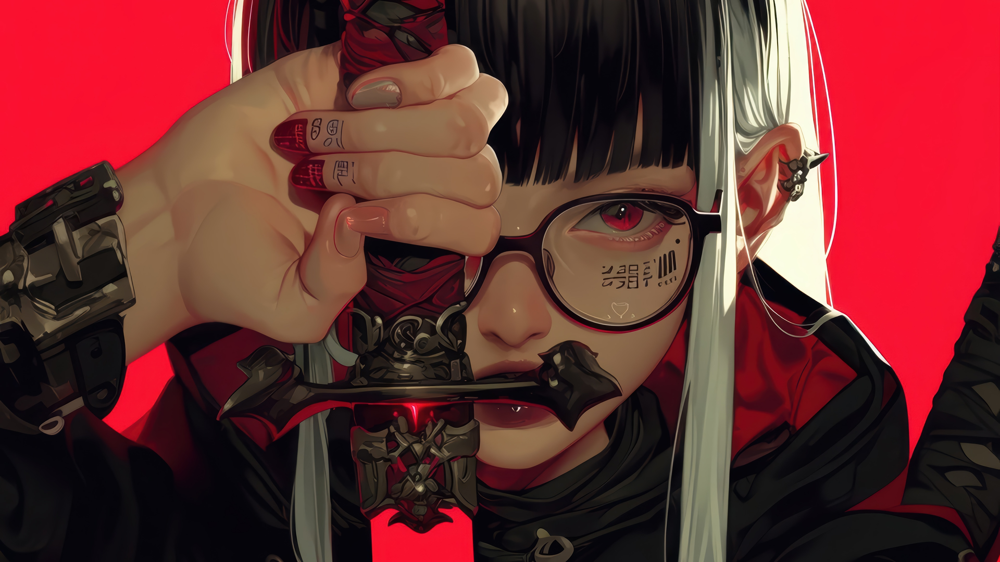

# 🎨 Matugen Dynamic Theme

A dynamic Material You wallpaper-driven theming suite and curated dark anime aesthetic for [Omarchy Linux](https://omarchy.org/) and Hyprland. Powered by [Matugen](https://github.com/InioX/matugen), this theme automatically extracts and harmonizes desktop color palettes in real-time directly from your active wallpaper.


## ✨ Features

- **Dynamic Material You Generation**: Automatically extracts harmonized color palettes from any active wallpaper using Matugen.
- **Live Wallpaper Aware**: Omarchy's video wallpapers (`.mp4`, `.webm`, ...) keep driving the palette. Matugen samples a poster or a representative video frame, so colors stay just as accurate as with stills.
- **Real-Time Wallpaper Watcher**: Inotify-based background daemon instantly re-themes your environment whenever you change or cycle wallpapers.
- **Whisper Window Borders**: Feather-light 1px 45° gradient transitioning from glowing primary accent to subtle translucent highlights, with a seamless borderless transparent inactive frame.
- **Dynamic Geometry**: Clean tiling geometry (`rounding = 6`, `gaps = 0`) paired with refined floating window curves (`rounding = 8` for dialogs, modals, and pickers).
- **Deep Obsidian Canvas**: `#13140c` rich OLED-friendly dark base with high contrast typography and clean Quickshell status bar integration.
- **Curated 4K Anime Wallpapers**: Includes 7 high-definition dark anime and cyberpunk stills plus 2 looping live wallpapers, tailored for instant palette harmony.
- **Complete App Coverage**: Themed Hyprland, Quickshell, Cava, Alacritty, Kitty, Foot, Ghostty, Neovim, Helix, Btop, and Obsidian.



## 🎨 Palette (Current Snapshot)

| Role | Color | Hex |
| :--- | :--- | :--- |
| **Background** | Deep Obsidian | `#13140c` |
| **Dark Background** | Dark Mantle | `#1c1c14` |
| **Darker Background** | Pure Crust | `#0e0f08` |
| **Lighter Background** | Surface High | `#2a2a22` |
| **Selection** | Olive Shade | `#454b04` |
| **Foreground** | Warm Cream | `#e5e3d6` |
| **Muted Text** | Muted Outline | `#929182` |
| **Primary Accent** | Chartreuse Gold | `#c5cc7a` |
| **Active Border** | Accent ➔ Translucent White (45°) | `rgba(c5cc7a77)` ➔ `rgba(ffffff33)` |
| **Inactive Border** | Subtle Ghost | `rgba(ffffff18)` |

### ANSI Colors

- **Normal**: `Black #13140c` | `Red #ffb3b3` | `Green #b1d18a` | `Yellow #d6c871` | `Blue #99ccfa` | `Magenta #e6b6f1` | `Cyan #8ad6b7` | `White #e5e3d6`
- **Bright**: `Black #929182` | `Red #ffdcdc` | `Green #c5dda7` | `Yellow #dfd491` | `Blue #c0dffc` | `Magenta #f2d8f8` | `Cyan #a8e1ca` | `White #e5e3d6`

> **Note**: In dynamic mode, these colors will automatically adapt whenever the wallpaper changes!

## 🖼️ Curated Wallpapers

Curated backgrounds included in `backgrounds/`:

1. `anime-warrior-with-sword-and-red-eye-in-4k-backiee-4K.jpg`
2. `cyberpunk-neko-girl-in-cherry-blossom-backiee-4K.jpg`
3. `monochrome-gothic-anime-girl-with-white-hair-and-intricate-tattoos-backiee-4K.jpg`
4. `mysterious-anime-girl-in-purple-hues-backiee-4K.jpg`
5. `nighttime-melody-at-the-tech-desk-backiee-4K.jpg`
6. `samurai-autumn-blade-in-anime-style-backiee-4K.jpg`
7. `tattooed-elegance-anime-girl-on-red-canvas-backiee-4K.jpg`

Cycle wallpapers at any time with:
```bash
omarchy theme bg next
```

### Live wallpapers included

Two silent 2560×1440 H.264 loops ship with the theme:

1. `samurai-over-sakura-valley-live.mp4` — a samurai overlooking a misty sakura valley at sunset.
2. `tokyo-skyline-bedroom-live.mp4` — a rain-streaked Tokyo apartment with the skyline at night.

They loop for about a minute, carry no audio track, and are encoded at 1440p because OWE renders at most `2560×1440` by default (`owe config`). The palette for each is sampled automatically from the video, so no poster is needed.

The repository ships 2560×1440 copies to keep the clone small. `install.sh` places them in `~/.config/omarchy/backgrounds/matugen/`, keeps a same-named full-resolution original you already have there, and silences any newly installed clip. Drop your own 4K originals in that folder if you prefer.

`omarchy theme bg next` cycles them together with the stills.

## 📹 Live Wallpapers

Live wallpapers are silent by default. OWE deliberately plays the audio of any video wallpaper that has one, and has no per-wallpaper mute switch, so the theme keeps its clips silent at the file level. `matugen-add-live` and the installer strip audio automatically; the video stream is copied bit-for-bit. To silence an existing file yourself:

```bash
matugen-silence ~/Videos/loop.mp4
```

The command replaces the file in place (or takes an output path) without re-encoding the video.

Omarchy 4.5 draws video backgrounds through OWE. Matugen still needs a still image, so the theme now resolves one automatically before every palette generation:

1. **Poster image (recommended)** — put `foo.jpg`, `foo.png` or `foo.webp` next to `foo.mp4`. The poster wins and gives you a stable, hand-picked palette.
2. **Automatic frame grab** — with no poster, `ffmpeg` samples a frame at 20% of the video (clamped to 0.2–8 seconds) and caches it in `~/.cache/matugen/frames/`.

Supported videos: `.mp4`, `.m4v`, `.mov`, `.webm`, `.mkv`, `.avi` (the same list Omarchy cycles through). GIF and WebP stills keep working exactly as before.

### Add a live wallpaper

Use the helper. It copies the clip into the user background folder, strips its audio track, and can make it the current wallpaper:

```bash
matugen-add-live --set ~/Videos/loop.mp4
```

Use `--keep-audio` to keep a track, or `--force` to replace a same-named clip. Videos can also be dropped into the folder directly, which survives theme updates and is **not** copied on every palette refresh:

```bash
omarchy theme bg install        # opens ~/.config/omarchy/backgrounds/matugen
```

Then cycle through stills and videos together:

```bash
omarchy theme bg next
omarchy theme bg set ~/Videos/wallpaper.mp4
```

The watcher notices the change, samples the video, regenerates `colors.toml`, and re-applies the theme — the desktop, bar and terminals recolour themselves.

> **Tip:** A video placed inside the theme directory
> (`~/.config/omarchy/themes/matugen/backgrounds/`) also works, and the installer now
> preserves that folder on update, but Omarchy copies the whole theme directory on
> every palette refresh, so large clips are better kept in the user background folder.

### Tune the sampled frame

```bash
MATUGEN_FRAME_TIME=4.5 matugen-omarchy     # sample 4.5s into the current video
```

`matugen-frame <path>` prints the exact still Matugen would use, which is handy for debugging a video that produces an unexpected palette.

`ffmpeg` and `ffprobe` are required for live wallpapers; the installer checks for them and installs them with `pacman` when it can.

## 🚀 Installation & Activation

The installer is completely automated, non-destructive, and works safely within user space (`~/.config/` and `~/.local/`). It never touches `/usr/share/omarchy/`, so your system stays 100% clean across `omarchy update`s.

### Quick Install (One-Liner)

Run the automated installer directly in your terminal:

```bash
git clone https://github.com/m7sh/matugen-theme.git /tmp/matugen-theme && /tmp/matugen-theme/install.sh
```

### Manual Install

If you prefer to clone and inspect before running:

```bash
git clone https://github.com/m7sh/matugen-theme.git
cd matugen-theme
./install.sh
```

### What the Installer Does Automatically

1. **Matugen Check/Install**: Installs the latest prebuilt `matugen` binary to `~/.local/bin/` if not already installed (no sudo required).
2. **Theme Deployment**: Installs the theme's 7 4K stills into `~/.config/omarchy/themes/matugen/` and the live videos into `~/.config/omarchy/backgrounds/matugen/`, never overwriting a same-named file so a local 4K original survives updates. Newly installed clips are silenced automatically.
3. **Template Setup**: Deploys dynamic Material You templates into `~/.config/matugen/templates/`.
4. **Automation Scripts**: Installs `matugen-omarchy`, `matugen-watch`, `matugen-sync`, `matugen-frame`, `matugen-add-live` and `matugen-silence` into `~/.local/bin/`.
5. **Dependency Checks**: Verifies `inotify-tools` for the watcher and `ffmpeg` for sampling live wallpapers.
6. **Omarchy Hook**: Registers an Omarchy `theme-set` hook to immediately adapt colors whenever the theme is applied.
7. **Daemon & Autostart**: Sets up and starts the `matugen-watch.service` systemd user service and registers it in `~/.config/hypr/autostart.lua`.
8. **Immediate Activation**: Automatically switches your desktop to the Matugen theme.

---

## ⌨️ Usage & Useful Commands

- **Cycle Wallpapers (with automatic real-time re-theming)**:
  ```bash
  omarchy theme bg next
  ```
- **List wallpapers (stills + live videos)**:
  ```bash
  matugen-sync --list
  ```
- **Manually Force Palette Regeneration**:
  ```bash
  matugen-omarchy
  ```
- **Show which still a live wallpaper is sampled from**:
  ```bash
  matugen-frame ~/Videos/wallpaper.mp4
  ```
- **Try another Material You scheme**:
  ```bash
  MATUGEN_SCHEME=scheme-vibrant matugen-omarchy
  ```
- **Check Wallpaper Daemon Status**:
  ```bash
  systemctl --user status matugen-watch.service
  ```
- **Restart Desktop Shell / Terminals (if needed)**:
  ```bash
  omarchy restart shell
  omarchy restart terminal
  ```
- **Switch back to Matugen from another theme**:
  ```bash
  omarchy theme set matugen
  ```

---

## 🗑️ Uninstallation

To cleanly remove the theme, service, and scripts without touching any core Omarchy configuration:

```bash
./install.sh --uninstall
```
