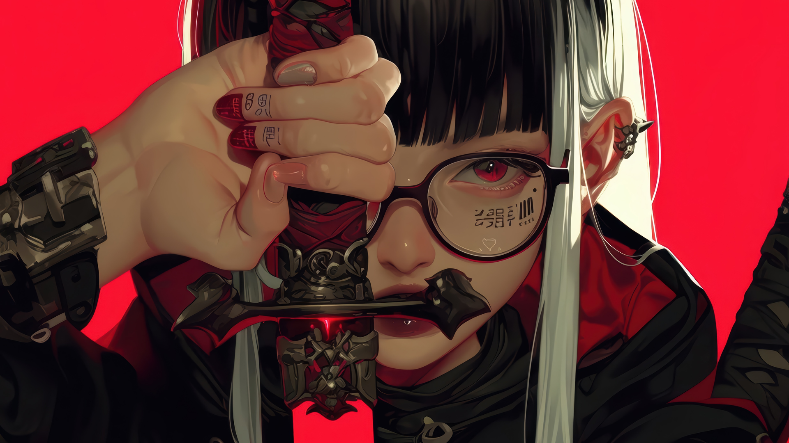

# 🎨 Matugen Dynamic Theme

A dynamic Material You wallpaper-driven theming suite and curated dark anime aesthetic for [Omarchy Linux](https://omarchy.org/) and Hyprland. Powered by [Matugen](https://github.com/InioX/matugen), this theme automatically extracts and harmonizes desktop color palettes in real-time directly from your active wallpaper.



## ✨ Features

- **Dynamic Material You Generation**: Automatically extracts harmonized color palettes from any active wallpaper using Matugen.
- **Real-Time Wallpaper Watcher**: Inotify-based background daemon instantly re-themes your environment whenever you change or cycle wallpapers.
- **Whisper Window Borders**: Feather-light 1px 45° gradient transitioning from glowing primary accent to subtle translucent highlights, with a seamless borderless transparent inactive frame.
- **Dynamic Geometry**: Clean tiling geometry (`rounding = 6`, `gaps = 0`) paired with refined floating window curves (`rounding = 8` for dialogs, modals, and pickers).
- **Deep Obsidian Canvas**: `#13140c` rich OLED-friendly dark base with high contrast typography and clean Quickshell status bar integration.
- **Curated 4K Anime Wallpapers**: Includes 7 high-definition dark anime and cyberpunk wallpapers tailored for instant palette harmony.
- **Complete App Coverage**: Themed Hyprland, Quickshell, Cava, Alacritty, Kitty, Foot, Ghostty, Neovim, Helix, Btop, and Obsidian.


## 🎨 Palette (Current Snapshot)

| Role | Color | Hex |
| :--- | :--- | :--- |
| **Background** | Deep Obsidian | `#13140c` |
| **Dark Background** | Dark Mantle | `#1c1c14` |
| **Darker Background** | Pure Crust | `#0e0f08` |
| **Lighter Background** | Surface High | `#2a2a22` |
| **Selection** | Olive Shade | `#454b04` |
| **Foreground** | Warm Cream | `#e5e3d6` |
| **Muted Text** | Muted Outline | `#929182` |
| **Primary Accent** | Chartreuse Gold | `#c5cc7a` |
| **Active Border** | Accent ➔ Translucent White (45°) | `rgba(c5cc7a77)` ➔ `rgba(ffffff33)` |
| **Inactive Border** | Subtle Ghost | `rgba(ffffff18)` |

### ANSI Colors

- **Normal**: `Black #13140c` | `Red #ffb3b3` | `Green #b1d18a` | `Yellow #d6c871` | `Blue #99ccfa` | `Magenta #e6b6f1` | `Cyan #8ad6b7` | `White #e5e3d6`
- **Bright**: `Black #929182` | `Red #ffdcdc` | `Green #c5dda7` | `Yellow #dfd491` | `Blue #c0dffc` | `Magenta #f2d8f8` | `Cyan #a8e1ca` | `White #e5e3d6`

> **Note**: In dynamic mode, these colors will automatically adapt whenever the wallpaper changes!

## 🖼️ Curated Wallpapers

Curated backgrounds included in `backgrounds/`:

1. `anime-warrior-with-sword-and-red-eye-in-4k-backiee-4K.jpg`
2. `cyberpunk-neko-girl-in-cherry-blossom-backiee-4K.jpg`
3. `monochrome-gothic-anime-girl-with-white-hair-and-intricate-tattoos-backiee-4K.jpg`
4. `mysterious-anime-girl-in-purple-hues-backiee-4K.jpg`
5. `nighttime-melody-at-the-tech-desk-backiee-4K.jpg`
6. `samurai-autumn-blade-in-anime-style-backiee-4K.jpg`
7. `tattooed-elegance-anime-girl-on-red-canvas-backiee-4K.jpg`

Cycle wallpapers at any time with:
```bash
omarchy theme bg next
```

## 🚀 Installation & Activation

The installer is completely automated, non-destructive, and works safely within user space (`~/.config/` and `~/.local/`). It never touches `/usr/share/omarchy/`, so your system stays 100% clean across `omarchy update`s.

### Quick Install (One-Liner)

Run the automated installer directly in your terminal:

```bash
git clone https://github.com/m7sh/matugen-theme.git /tmp/matugen-theme && /tmp/matugen-theme/install.sh
```

### Manual Install

If you prefer to clone and inspect before running:

```bash
git clone https://github.com/m7sh/matugen-theme.git
cd matugen-theme
./install.sh
```

### What the Installer Does Automatically

1. **Matugen Check/Install**: Installs the latest prebuilt `matugen` binary to `~/.local/bin/` if not already installed (no sudo required).
2. **Theme Deployment**: Installs the theme and all 7 4K wallpapers into `~/.config/omarchy/themes/matugen/`.
3. **Template Setup**: Deploys dynamic Material You templates into `~/.config/matugen/templates/`.
4. **Automation Scripts**: Installs `matugen-omarchy`, `matugen-watch`, and `matugen-sync` into `~/.local/bin/`.
5. **Omarchy Hook**: Registers an Omarchy `theme-set` hook to immediately adapt colors whenever the theme is applied.
6. **Daemon & Autostart**: Sets up and starts the `matugen-watch.service` systemd user service and registers it in `~/.config/hypr/autostart.lua`.
7. **Immediate Activation**: Automatically switches your desktop to the Matugen theme.

---

## ⌨️ Usage & Useful Commands

- **Cycle Wallpapers (with automatic real-time re-theming)**:
  ```bash
  omarchy theme bg next
  ```
- **Manually Force Palette Regeneration**:
  ```bash
  matugen-omarchy
  ```
- **Check Wallpaper Daemon Status**:
  ```bash
  systemctl --user status matugen-watch.service
  ```
- **Restart Desktop Shell / Terminals (if needed)**:
  ```bash
  omarchy restart shell
  omarchy restart terminal
  ```
- **Switch back to Matugen from another theme**:
  ```bash
  omarchy theme set matugen
  ```

---

## 🗑️ Uninstallation

To cleanly remove the theme, service, and scripts without touching any core Omarchy configuration:

```bash
./install.sh --uninstall
```
